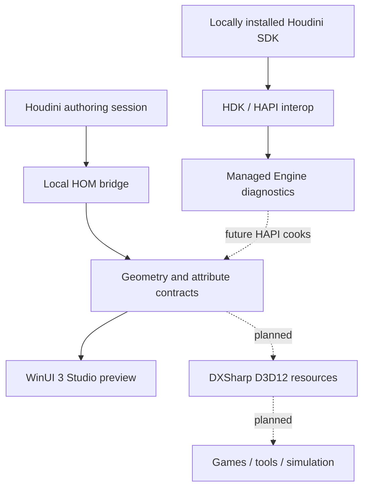

<p align="center">
  
</p>
<h1 align="center">DXSharp.Houdini</h1>
<p align="center"><strong>Procedural authoring, geometry interchange and GPU workloads for the DXSharp ecosystem.</strong></p>
<p align="center">
  <a href="https://github.com/atcarter714/DXSharp">DXSharp SDK</a> ·
  <a href="https://www.sidefx.com/">SideFX Houdini</a> ·
  <a href="https://github.com/atcarter714/DXSharp.Houdini/actions">Builds</a> ·
  <a href="https://github.com/atcarter714/DXSharp.Houdini/issues">Issues</a>
</p>
<p align="center">
  
  
  
  
  
</p>

## Overview

DXSharp.Houdini is an independent integration project connecting the procedural authoring capabilities of Houdini with modern .NET applications and the DXSharp graphics and compute ecosystem. Its goal is to make procedural assets, artist-authored geometry and structured attributes usable in custom game engines, simulation software, content pipelines and editor tools.

The project deliberately separates Houdini's native SDKs, managed geometry contracts and GPU integration. Applications should be able to consume baked assets without requiring a live authoring session. A licensed Houdini installation remains necessary for live Houdini operations.

> [!NOTE]
> This repository is experimental. `main` contains the initial managed/native interoperability foundation. The [active Studio branch](https://github.com/atcarter714/DXSharp.Houdini/tree/feature/houdini-studio) adds the working interactive HOM bridge and WinUI 3 editor described below. The native HAPI session and cooking pipeline is a separate, not-yet-qualified milestone.

## Scene pipeline development

The [scene-pipeline branch](https://github.com/atcarter714/DXSharp.Houdini/tree/feature/scene-pipeline) adds a first native D3D12 shaded viewport, strict SOP/USD mesh compilation, direct material/texture preview, Copernicus float layer export and opt-in Hydra ABI/AOV probes. These are development changes pending Windows/Houdini qualification. See [the v0.5 workflow](docs/scene-pipeline.md) on that branch.

## Integration layers

| Layer | Responsibility | Status |
| --- | --- | --- |
| HOM (Python) | Interactive Houdini scene operations, metadata, parameters and cooked geometry | Studio branch |
| HAPI (Houdini Engine) | Native client discovery and version diagnostics; future independent sessions and HDA cooking | Version probe implemented |
| HDK (C++) | Exact-version native ABI probe and minimal pass-through SOP; future compute operators | Build/load qualification pending |
| Geometry | SDK-independent topology, canonical attribute semantics and conversion contracts | Foundation; attribute extensions on Studio branch |
| DXSharp | D3D12 resource and workload integration | GPU asset upload planned |

## Houdini Studio

[Houdini Studio](https://github.com/atcarter714/DXSharp.Houdini/tree/feature/houdini-studio/samples/HoudiniStudio) is the experimental WinUI 3 reference editor. It connects to a running Houdini instance through an explicitly enabled local HOM bridge rather than an independent HAPI session.

The development branch demonstrates:

- Session discovery and automatic connection when one session is available.
- Hierarchical OBJ/SOP browsing, searchable installed SOP catalog and trusted HDA library installation.
- Typed scalar, vector, color, menu, toggle, string and existing ramp-key editors.
- Parameter editing, queued synchronization, recook and selected-SOP live updates.
- BGEO import/export, wireframe/shaded preview and point-owned `Cd` visualization.
- Read-only attribute inspection and camera following, with projection support in compatible contexts.
- Resizable inspector, project/environment inspection, persistent settings and bridge cleanup.

The preview currently uses a depth-buffered **CPU bitmap rasterizer**, not a native D3D12 viewport. Creation is SOP-only, ramp editing is limited, materials and textures are incomplete, and camera following does not modify Houdini's camera. A proper GPU viewport and full attribute transport are planned.

[Studio setup and workflow](https://github.com/atcarter714/DXSharp.Houdini/blob/feature/houdini-studio/docs/studio.md)

## Getting started

### Compatibility target

| Component | Initial target |
| --- | --- |
| Houdini | 22.0.514 |
| HDK API | 22000475 |
| Houdini Engine | 9.0 |
| HAPI API | 0 |
| DXSharp.Core | 0.4.0-preview.4 |
| .NET / platform | .NET 10 / Windows x64 |

Use the exact matching local Houdini toolkit for native compilation. The managed build and deterministic verification can run without Houdini installed.

```powershell
git clone https://github.com/atcarter714/DXSharp.Houdini.git
cd DXSharp.Houdini
pwsh -File eng/build.ps1
```

Open `DXSharp.Houdini.slnx` to build or debug projects individually.

### Connect Houdini Studio

```powershell
git switch feature/houdini-studio
pwsh -File eng/build.ps1
pwsh -File eng/install-houdini-package.ps1
```

1. Restart Houdini and add the **DXSharp** shelf from the shelf menu.
2. Click **Connect** in Houdini to start the bridge.
3. Run the Studio sample:

```powershell
dotnet run --project samples/HoudiniStudio -c Release --no-build
```

4. Select a discovered session if necessary, then browse the scene or create a SOP. Use **Disconnect** in Houdini when finished.

The installer registers the repository's Houdini package in the active user preferences directory. It does not require or modify any private Arkaen package. Use `-PreferenceDirectory` for a custom profile and `-Uninstall` to unregister.

Only enable the bridge for trusted local processes. It uses a local temporary directory, not a network listener; requests can modify the open Houdini scene. Save or use a disposable scene before experimentation. See the Studio guide for transport, timeout and cleanup behavior.

### Native SDK diagnostics and HDK build

```powershell
$HoudiniRoot = 'C:/Program Files/Side Effects Software/Houdini 22.0.514'

dotnet run --project samples/Diagnostics -- --root $HoudiniRoot

pwsh -File eng/build.ps1 -HoudiniRoot $HoudiniRoot -Native
```

Native compilation requires the matching Houdini toolkit, CMake and supported MSVC toolset. Check `hcustom --output_compiler_range` in Houdini Command Line Tools.

The diagnostic program queries the native client version without creating a session or consuming a license. It does not validate HAPI cooking or license entitlement. The native build stages the ABI probe and pass-through SOP; it does not install the plugin into the user profile. See [native qualification](docs/qualification.md).

## Architecture



Geometry contracts must preserve Houdini's point, vertex/corner, primitive and detail domains. Vertex expansion across UV seams and hard normals, topology triangulation, coordinate conventions and typed GPU formats are explicit integration concerns, not assumptions to hide in a renderer.

| Directory | Responsibility |
| --- | --- |
| [src/DXSharp.Houdini.Interop](src/DXSharp.Houdini.Interop) | Native discovery, loading and version interrogation |
| [src/DXSharp.Houdini.Engine](src/DXSharp.Houdini.Engine) | Version policy and runtime diagnostics |
| [src/DXSharp.Houdini.Geometry](src/DXSharp.Houdini.Geometry) | Renderer-independent geometry |
| [src/DXSharp.Houdini](src/DXSharp.Houdini) | DXSharp-facing integration |
| [native](native) | HDK and HAPI qualification sources |
| [samples/Diagnostics](samples/Diagnostics) | Client version diagnostics |
| [samples/HoudiniStudio](https://github.com/atcarter714/DXSharp.Houdini/tree/feature/houdini-studio/samples/HoudiniStudio) | Experimental live editor (Studio branch) |
| [tests/Verification](tests/Verification) | Deterministic verification |
| [eng](eng) | Build and compatibility automation |

## Roadmap

- [x] Managed SDK discovery, version diagnostics and topology foundation
- [x] Interactive HOM bridge and Studio proof of concept (development branch)
- [ ] Complete native ABI and HDK plugin qualification
- [ ] Licensed HAPI session lifecycle, HDA cooking and SessionSync
- [ ] Domain-aware attribute expansion, materials, binary transport and GPU resource upload
- [ ] Reusable D3D12 editor viewport and bidirectional camera/selection synchronization
- [ ] HDK compute SOP and explicit GPU workload ownership
- [ ] Baked asset pipeline, documentation and package release qualification

## Documentation and ecosystem

[Architecture](docs/architecture.md) · [Native qualification](docs/qualification.md) · [Studio workflow](https://github.com/atcarter714/DXSharp.Houdini/blob/feature/houdini-studio/docs/studio.md)

SideFX references: [HDK](https://www.sidefx.com/docs/hdk/) · [Houdini Engine](https://www.sidefx.com/docs/hengine/) · [HOM](https://www.sidefx.com/docs/houdini/hom/)

| Project | Purpose |
| --- | --- |
| [DXSharp](https://github.com/atcarter714/DXSharp) | Modern .NET / DirectX SDK and GPU workload infrastructure |
| [DXSharp.Noesis](https://github.com/atcarter714/DXSharp.Noesis) | XAML interfaces and interactive graphics integration |
| **DXSharp.Houdini** | Procedural authoring and asset interoperability |

## Licensing and contributions

Houdini, Houdini Engine and the HDK are separately licensed by SideFX. Custom HAPI integration licensing must be established before live asset execution. No SideFX SDK binaries, proprietary scenes, private Arkaen code or generated SideFX bindings are distributed here. A public repository does not itself grant a license to reuse its code; consult the repository owner for applicable terms until an explicit project license is provided.

Maintained by **Arkaen Solutions**. Reproducible issues and technical feedback are welcome. Include the Houdini build, HDK/HAPI version, .NET SDK, relevant project or branch and diagnostic logs. Keep licenses, private assets and confidential environment data out of public issue reports.
